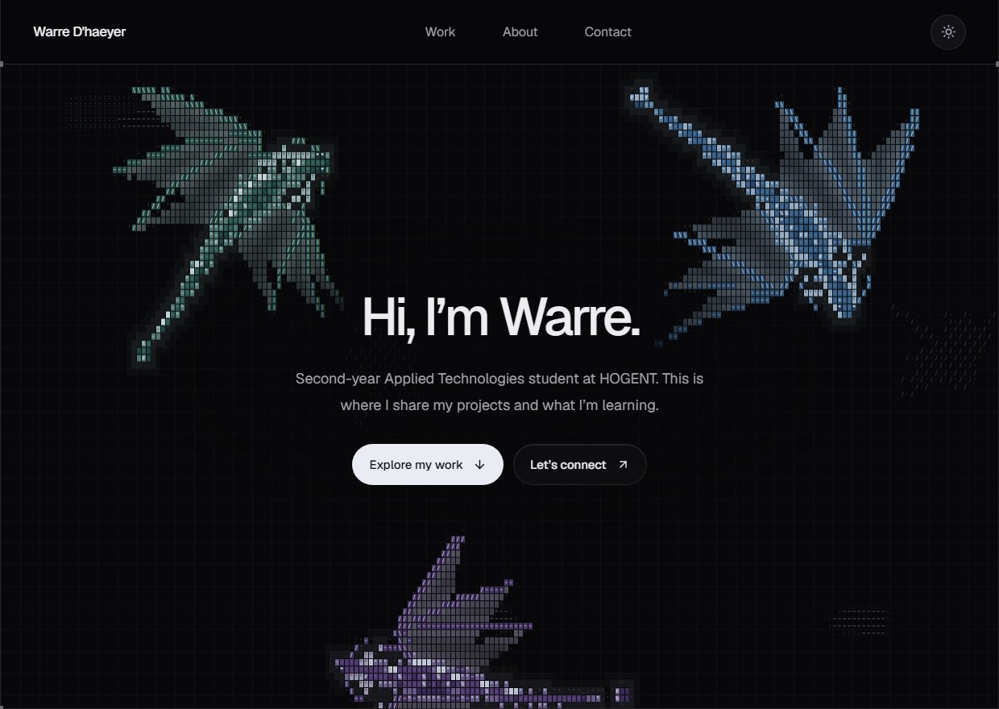

# Warre D'haeyer — portfolio

A one-page personal portfolio for an Applied Technologies student at HOGENT.
Built with React, TypeScript, Vite, React Compiler, and Tailwind CSS.



## Features

- Responsive layout with persistent light/dark themes.
- Decorative ASCII storm dragons and heading/image scroll reveals.
- Reduced-motion preferences, keyboard navigation, and visible focus states.
- Projects, education, confirmed technologies/tools, and contact links.
- Frontend-only contact draft composer: opens an email app, never sends or stores submissions.

This portfolio is the first featured project. The other two cards are explicitly
labeled placeholders, not completed projects.

## Run locally

Install **Node.js 24 LTS (24.11 or newer)**, npm, and Git. Run these commands from
the `warredhaeyer` repository root:

```sh
npm ci
npm run dev
```

No environment variables, API keys, or backend are required. Installation needs
network access to npm and GitHub; ASCII Reveal is pinned to a specific upstream
commit and fetched over HTTPS.

## Checks

Run these commands from the repository root:

```sh
npm run lint
npm run build
npx playwright install chromium
npm run test:e2e
```

On Linux, use `npx playwright install --with-deps chromium` to install browser
system dependencies as well. Playwright starts the development server itself.
Tests cover content, navigation, themes, contact drafts, responsive layouts,
scroll reveals, and live reduced-motion changes.

GitHub Actions runs installation, lint, build, and Chromium browser tests on pushes
and pull requests.

## Structure

```text
warredhaeyer/
  .github/         Automated checks
  LICENSE          Project MIT license
  README.md        Setup, customization, and deployment
  public/          Favicon, images, and font license
  src/
    components/    Portfolio sections and animation integrations
    hooks/         Active-section navigation
    vendor/        Adapted storm-dragon renderer and upstream license
    content.ts     Profile, projects, education, skills, and links
    index.css      Theme tokens and responsive styles
  tests/           Playwright regressions
```

## Customize

Edit `src/content.ts` to change the profile, projects, skills, and contact
links. Replace the project images in `public/images/` and update their
descriptions/alt text. Replace the portfolio screenshot after visual changes.
Page title and description are in `index.html`.

When reusing this site, replace the personal details and imagery with your own.
Missing contact links can be set to `null`; the UI shows an unavailable state
instead of a broken link. The contact form remains a local draft composer, not
an email delivery service.

## Build and deploy

From the repository root, run `npm run build` and deploy **`dist/`** to a static
host at the domain root. Use `npm run preview` to check the production build locally.
On hosts with repository settings, use the repository root as the project directory,
`npm ci && npm run build` as the build command, and `dist` as the output directory.

The current asset URLs assume `/`. Deployment under a subdirectory (such as
GitHub Pages at `/repository-name/`) needs Vite base-path configuration **and**
updates to the root-relative image/favicon URLs; it is not configured here.

Keep `dependency-licenses.txt` and `licenses/` in the deployed output. The workflow
checks the project but does not publish or deploy it.

## License and credits

The portfolio code is available under the [MIT License](LICENSE). Third-party
components retain their respective licenses.

- [ASCII Reveal](https://github.com/quanhoangindex/ascii-reveal) by Quan Hoang
  powers the text/image effects. The storm-dragon renderer and aspects of the
  visual layout are adapted from its MIT-licensed demo.
- React and Tailwind CSS: MIT.
- Lucide icons: ISC, with inherited Feather MIT notices.
- Geist and Geist Mono: SIL Open Font License 1.1.

See [third-party notices](THIRD-PARTY-NOTICES.md) for provenance and license
locations.
